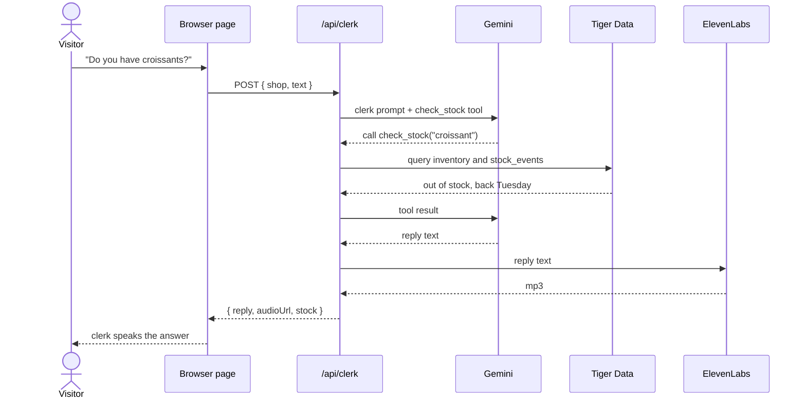

# Peripie: execution plan

Product name: Peripie (say "PAIR-ih-pie"), from the Greek emperipateo, "to walk about among." HackLanta '26, solo entry.
**Submission deadline: Sunday Oct 11, 9:00 am ET. Feature freeze: 7:00 am.**

This file is the single source of truth for everyone working on the repo: Claude Code, its subagents, Ollama, and Sergio. If something here conflicts with a chat message from Sergio, Sergio wins, and this file gets updated in the same commit.

## 1. What we are building

A small shop's website that you walk into. The visitor sees the storefront from the street, the camera moves through the door, and a clerk at the counter greets them out loud. The visitor asks for a product, the clerk checks with a stock agent, and answers by voice: in stock, or out of stock and back on a given date.

The audience is small local shops, which the existing virtual-store platforms (Obsess, Emperia) do not serve; they sell to large brands. Sergio runs a small business himself, and the pitch opens with that.

Where we compete:

| Entry | What earns it |
|---|---|
| AI/ML track | Two agents with a visible hand-off that take a real task off a shop owner's plate |
| Replit "Small Business" challenge | A working, creative small business app hosted on Replit |
| Best Use of ElevenLabs | The clerk's voice is the product |
| Best Use of Gemini API | Gemini runs the clerk and decides when to call the stock tool |
| Best Use of Tiger Data | Restock history as time-series data, used in the clerk's answers |
| Zero Data challenge | No accounts, tracking, profiles, or stored personal info |
| GoDaddy Registry | A good domain name |

Not used, on purpose: Auth0 (logins contradict Zero Data), Vultr (Replit hosts it), Solana (no checkout in scope).

## 2. Definition of done

The demo succeeds if a judge can do this on the deployed link, from their own phone:

1. Open the site, pick the bakery, tap "Enter shop."
2. Hear the clerk's greeting in an ElevenLabs voice.
3. Ask for an in-stock item and an out-of-stock item, by typing or speaking.
4. Hear correct answers that come from the database, including a restock date.

Everything else is secondary to those four steps working every time.

## 3. Architecture

```
Browser (public/index.html, Three.js)
   |  POST /api/clerk  { shop, text }
   v
Node + Express server (server/index.js)  -- hosted on Replit
   |-- Gemini API: clerk persona + check_stock tool
   |       `-- check_stock(shop, product) -> SQL query
   |               `-- Tiger Data (Postgres): inventory, stock_events
   `-- ElevenLabs API: reply text -> mp3
   ^
   |  { reply, audioUrl, stock }
Browser plays audio, animates clerk
```

### The contract (do not change without the staff engineer's sign-off)

Request: `POST /api/clerk`, JSON body
```json
{ "shop": "bakery", "text": "do you have croissants?" }
```

Response: 200, JSON
```json
{
  "reply": "We're out of croissants right now. They'll be back Tuesday morning.",
  "audioUrl": "data:audio/mpeg;base64,...",
  "stock": { "product": "croissant", "inStock": false, "nextRestock": "2026-10-13" }
}
```

- `reply` is always present. `audioUrl` and `stock` may be null.
- `audioUrl` is a base64 data URL, so no audio file is ever written to disk.
- If ElevenLabs fails, return the reply with `audioUrl: null`; the page falls back to the browser's voice.
- If Gemini fails, return HTTP 502; the page falls back to its canned answers.
- Keep replies to one or two short sentences. They are spoken aloud.

### Data model (Tiger Data)

```
inventory(shop_id text, product text, on_hand int, next_restock date,
          primary key (shop_id, product))
stock_events(ts timestamptz, shop_id text, product text, on_hand int)   -- hypertable on ts
```

`check_stock` returns `{ product, inStock, onHand, nextRestock, typicalRestockDays }`. `typicalRestockDays` is computed from `stock_events` (average gap between an item hitting zero and coming back). That number is what makes this a real use of a time-series database, so the clerk should use it: "that usually comes back within three days."

Seed three shops to match the `SHOPS` list in the page: `bakery`, `paint`, `plants`.

### Repo layout

```
PLAN.md            this file
TASKS.md           live task board (section 7)
public/index.html  the 3D page (starts as the existing shop.html)
server/index.js    Express app, /api/clerk
server/clerk.js    Gemini call and tool loop
server/stock.js    check_stock and SQL
server/voice.js    ElevenLabs call
db/schema.sql      tables
db/seed.sql        seed data
.env.example       variable names only, never real keys
.claude/agents/    subagent definitions (section 6)
README.md          project page for judges (section 10)
docs/              diagrams, decision log, screenshots (section 10)
```

Environment variables: `GEMINI_API_KEY`, `ELEVENLABS_API_KEY`, `ELEVENLABS_VOICE_ID`, `DATABASE_URL`. On Replit these go in Secrets. `.env` is in `.gitignore` from the first commit.

## 4. Rules for everyone

1. **Look up SDK calls; do not write them from memory.** Gemini (`@google/genai`), ElevenLabs (`@elevenlabs/elevenlabs-js`) and Tiger Data all change often. Before writing a call, read the current quickstart and confirm the package name, the function signature and the model id. This is the most likely source of lost hours.
2. **Zero Data is a hard constraint.** No accounts, cookies, analytics, or local storage of anything about the visitor. The server must not log or store the visitor's text. Server logs may record timing and error types only.
3. **Keys stay on the server.** Nothing secret in `public/`, in git, or in a prompt pasted to Ollama.
4. **One owner per file at a time.** Claim it in `TASKS.md` before editing.
5. **Commit after every working step**, with a message that says what now works. Git is how the agents and Ollama see each other's work.
6. **Keep the fallback.** The page must still demo with canned answers and the browser voice if the network or an API fails at the venue.
7. **No new scope.** Checkout, owner accounts, a world builder and walkable 3D are for the pitch's "where this goes" slide.

## 5. Order of work

| Block (ET) | Goal | Check before moving on |
|---|---|---|
| Sat 1:30 to 3 pm | Repo scaffold, schema and seed loaded, `/api/clerk` answering locally with Gemini and a real stock lookup | `curl` returns a correct reply for one in-stock and one out-of-stock item |
| 3 to 6 pm | ElevenLabs audio, page wired to the endpoint, deployed on Replit | The four steps in section 2 pass on a phone |
| 6 to 9 pm | Mic input, `typicalRestockDays`, visual polish from Sergio's screenshots | Each one works without breaking section 2 |
| 9 to 11 pm | Domain, README, submission text, pitch draft | Submission form is filled in and saved as a draft |
| Sun 6 to 9 am | Rehearse, final checks, submit by 8:30 | Submitted |

**Cut rule:** if the 3 pm check has not passed by 6 pm, drop mic input and `typicalRestockDays` and spend the evening on the endpoint and the deploy.

### Must have
- [ ] M1. Scaffold: Express server serving `public/` and `/api/clerk`
- [ ] M2. Schema and seed data in Tiger Data
- [ ] M3. `check_stock` reading from the database
- [ ] M4. Gemini clerk with `check_stock` as a tool, scoped to the current shop
- [ ] M5. ElevenLabs audio returned as a data URL
- [ ] M6. Page: set `CLERK_ENDPOINT` to `/api/clerk`; on any endpoint error, fall back to the canned answers already in the file
- [ ] M7. Deployed on Replit and tested on a phone

### Should have
- [ ] S1. Mic input (Web Speech API in Chrome), with typing kept as the fallback
- [ ] S2. `typicalRestockDays` from `stock_events`, used in the clerk's answer
- [ ] S3. Domain registered and pointed at the app
- [ ] S4. README and docs/ as specified in section 10
- [ ] S5. Two-minute pitch

### Only if everything above is done
- [ ] N1. Owner can upload a storefront photo for the sign and walls
- [ ] N2. A greeting that changes with the time of day

## 6. Agents

Create these four files under `.claude/agents/` as the first step. Builders run on Opus. There is exactly one staff engineer, on Fable, and it is used sparingly because Fable usage is limited: at the four checkpoints below, and when a builder is stuck after two attempts.

If the `fable` model is not available or is over its usage limit, change the staff engineer's `model` to `opus` and continue.

**Staff engineer checkpoints**
1. Before any code: review this plan and the contract.
2. After M4: review the Gemini tool loop and the SQL.
3. After M7: review the deployed app against section 2 and the Zero Data rule.
4. At feature freeze: final pass, listing only demo-breaking problems.

`.claude/agents/staff-engineer.md`
```markdown
---
name: staff-engineer
description: Reviews plans and code at checkpoints, owns the API contract, and unblocks builders who are stuck after two attempts. Use at the four checkpoints in PLAN.md, not for routine work.
model: fable
tools: Read, Grep, Glob, Bash
---
You are the staff engineer on Peripie, a solo hackathon project due Sunday 9:00 am ET. Read PLAN.md first.

You review; you do not build features. For each review, report only what would break the demo, violate the API contract in PLAN.md section 3, or violate the Zero Data rule in section 4. Give each finding as: the file and line, what goes wrong, and the smallest fix. Skip style comments and refactors, because there is no time to act on them.

When a builder is stuck, find the cause and hand back a specific fix. If the fix needs an SDK call, read the current docs before recommending it.

You are the only one who may approve a change to the contract. If you approve one, update PLAN.md in the same change.
```

`.claude/agents/backend.md`
```markdown
---
name: backend
description: Builds the Node server: /api/clerk, the Gemini clerk with its check_stock tool, and the ElevenLabs voice call. Use for tasks M1, M4, M5.
model: opus
---
You build the server for Peripie. Read PLAN.md first; the contract in section 3 is fixed.

Own: server/index.js, server/clerk.js, server/voice.js, .env.example.

Before writing any Gemini or ElevenLabs call, read the current quickstart and confirm the package name, function signature and model id; do not rely on memory for these. The clerk speaks its replies aloud, so instruct the model to answer in one or two short sentences and to call check_stock whenever a product is mentioned, never guessing at stock. Do not log or store the visitor's text. Handle failures as the contract describes. Verify each step with curl before reporting it done, and say plainly what you did not test.
```

`.claude/agents/data.md`
```markdown
---
name: data
description: Builds the Tiger Data schema, seed data, and the check_stock query. Use for tasks M2, M3, S2.
model: opus
---
You build the data layer for Peripie. Read PLAN.md first.

Own: db/schema.sql, db/seed.sql, server/stock.js.

Tiger Data is Postgres with time-series features. Read its current quickstart before using any time-series function. Seed the three shops so their products match the SHOPS list in public/index.html, with a mix of in-stock and out-of-stock items and about 60 days of stock_events per product so restock gaps can be computed. check_stock must match loosely ("croissants" finds "croissant") and must use parameterized queries. Return the shape given in PLAN.md section 3. Show the query results that prove it works.
```

`.claude/agents/frontend.md`
```markdown
---
name: frontend
description: Maintains the Three.js shop page: wiring to the endpoint, fallback behavior, mic input, and visual polish. Use for tasks M6, S1, N1, N2.
model: opus
---
You maintain the page for Peripie. Read PLAN.md first.

Own: public/index.html.

The page already has three shop templates, the walk-in camera move, the clerk's three states (listening, checking, answering) and canned answers. Keep all of that working. Wire it to /api/clerk per the contract, and on any endpoint error fall back to the canned answers so the demo survives a network failure. Store nothing about the visitor: no cookies, local storage or analytics. You cannot see the rendered page, so after a visual change, say what Sergio should look at and ask for a screenshot.
```

## 7. Working with Ollama

Ollama (through Aider or a chat window) takes small jobs where a wrong answer is obvious. It does not write SDK calls and does not edit a file an agent has claimed.

Good Ollama jobs: more seed rows for `db/seed.sql`, CSS tweaks, explaining an error message, drafting README sections, drafting the submission text.

`TASKS.md` is the shared board. Create it with this format and keep it current:

```markdown
| ID | Task | Owner | Files | Status |
|----|------|-------|-------|--------|
| M1 | Scaffold server | backend | server/index.js | in progress |
| -  | 20 more seed rows for the plant shop | ollama | db/seed.sql | todo |
```

Owner is one of: `backend`, `data`, `frontend`, `staff-engineer`, `ollama`, `sergio`. If Ollama has edited a file, the next agent to touch it re-reads it first.

## 8. What only Sergio can do

- [ ] Get the keys: Gemini (Google AI Studio), ElevenLabs, and a Tiger Data database URL
- [ ] Pick an ElevenLabs voice and note its voice id
- [ ] Create the Replit project and add the four secrets
- [ ] Register the domain (ask the MLH table for a free domain code)
- [ ] Ask organizers: can one project enter a track plus several challenges and side quests?
- [ ] Ask Replit: does code written elsewhere and hosted on Replit count as "with Replit"?
- [ ] Ask Shock Tracker: does sending the visitor's question to Gemini and ElevenLabs, with nothing stored, satisfy Zero Data?
- [ ] Read the MLH prize page for each side quest's exact criteria
- [ ] Send screenshots after visual changes
- [ ] Capture the screenshot list in section 10 and record the demo video
- [ ] Rehearse the pitch out loud twice

## 9. Demo script

1. "I run a painting company. My customers call to ask one thing: do you have it. This answers that, at the door."
2. Open the bakery, enter, let the greeting play.
3. Ask for sourdough (in stock), then croissants (out, with a restock date).
4. Switch to the paint store to show the same code running a different shop.
5. Close with what's next: owners uploading their own storefront, checkout, and running the clerk on the shop's own hardware.

Tested questions only. Keep a second device open on the deployed link in case the first fails.

## 10. Documentation

Judges at MLH events usually read the repo and the submission page before they see the live demo, so the documentation is part of the entry. Capture it as each piece starts working, because the final hours go to rehearsal.

The format below is the one experienced MLH hackers use: a README that follows the Devpost story headings, a small set of standard diagrams, numbered screenshots, and a short demo video.

### README.md, in this order

1. Name, one-line pitch, and a hero GIF or screenshot of the walk-in
2. Links: live demo, demo video, submission page
3. **Inspiration**: the small-shop problem, in Sergio's own voice as a business owner
4. **What it does**: the four steps from section 2, with screenshots
5. **How we built it**: the architecture diagram, plus a table of each sponsor technology and what it does in the product (Gemini, ElevenLabs, Tiger Data, Replit)
6. **Zero Data statement**: what is never collected or stored, and what is sent to which API to answer a question
7. **Challenges we ran into**
8. **Accomplishments we're proud of**
9. **What we learned**
10. **What's next**
11. Run it locally: setup steps and the four environment variable names

### docs/

| File | Contents | Diagram type |
|---|---|---|
| `docs/architecture.md` | The system and its external services | Mermaid `flowchart` |
| `docs/sequence.md` | One question, from the visitor's words to the spoken answer | Mermaid `sequenceDiagram` |
| `docs/data-model.md` | The two tables and how they relate | Mermaid `erDiagram` |
| `docs/user-flow.md` | The visitor's path: street, door, counter, question, answer | Mermaid `flowchart` plus screenshots |
| `docs/decisions.md` | The idea log: each concept considered, why it was kept or cut | Table and short notes |
| `docs/screenshots/` | Numbered PNGs from the list below | |

Write diagrams in Mermaid inside the Markdown files. GitHub renders Mermaid without any tooling, and the source stays editable. Agents cannot see the rendered result, so Sergio checks each diagram on GitHub after it is pushed.

Starting point for the sequence diagram:



### The idea log (`docs/decisions.md`)

Record how the idea was reached, since judges ask "why this?" Include the concepts that were dropped and the reason for each: Mise (meal planner; crowded category), Proof (AI car condition report; Cox Automotive already ships photo-based damage detection), the bookkeeper that forgets (many statement analyzers exist), and the virtual shop that became Peripie (existing platforms serve large brands, none found for small local shops). Add each technical decision as it is made, one line each: what was chosen, what was rejected, why.

### Screenshot list (Sergio captures; save as `docs/screenshots/NN-name.png`)

1. `01-street.png`: the storefront from the street
2. `02-doors.png`: the doors opening
3. `03-greeting.png`: the clerk greeting the visitor
4. `04-checking.png`: the clerk turned to the stock agent
5. `05-answer.png`: an out-of-stock answer with a restock date
6. `06-second-shop.png`: a different shop template
7. `07-phone.png`: the app on a phone

### Demo video

Two minutes, following the demo script in section 9. Record it Saturday night once section 2 passes, so a working recording exists even if something breaks on Sunday. Check the submission form for the required length and host.

### Who does what

- `backend`, `data` and `frontend` each add their part to the diagrams and the "How we built it" section when they finish a task.
- Ollama drafts the README prose from the notes in this file.
- The staff engineer checks at checkpoint 3 that the diagrams match the code.
- Sergio captures screenshots, records the video, and reviews the rendered diagrams.
