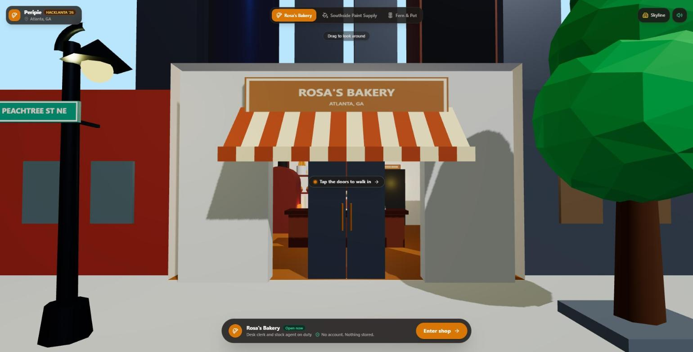
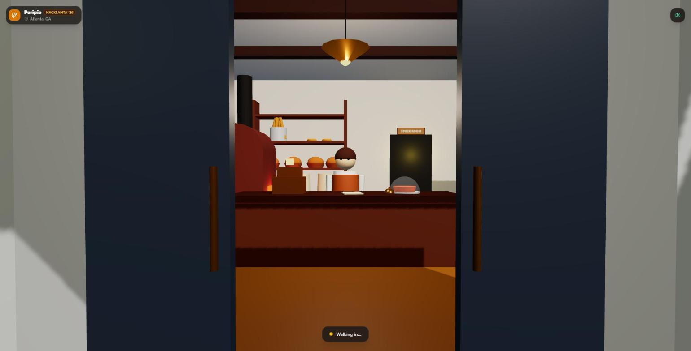
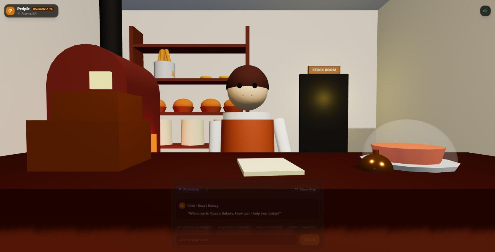
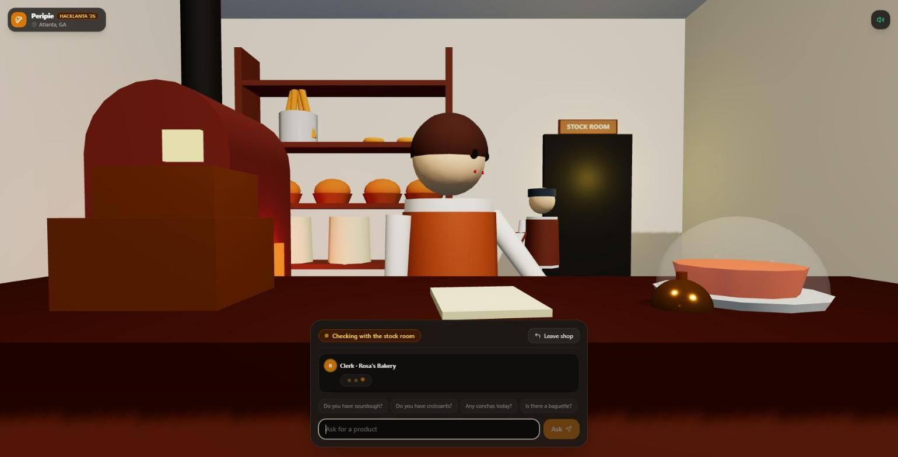
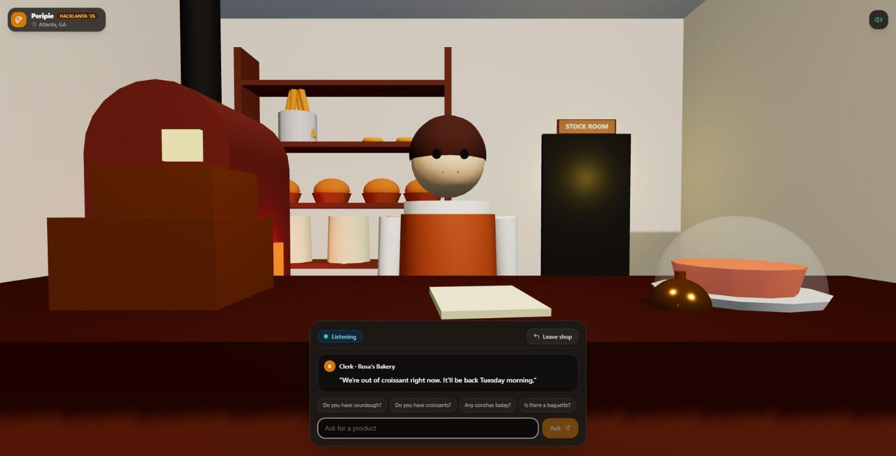

# Peripie

Walk into a small shop's website and ask the clerk. A 3D storefront with a voice agent that checks live stock. Built at HackLanta '26.



**Live demo:** coming after deploy · **Demo video:** coming Saturday night · **Submission:** coming

## Inspiration

I run a painting company. My customers call to ask one thing: do you have it? I don't want them to wait on hold or drive by if the paint isn't there. The virtual-store platforms that exist (Obsess, Emperia) sell to large brands with huge catalogs; nobody serves small local shops like mine. This started because I needed a simple way for my business to answer that question without hiring more staff or buying expensive software.

Some days I'm also the customer who won't ask. I'll order at a drive-through before I'll ask at a counter, and a website can't answer the question anyway. Peripie is a counter you can walk up to from wherever you are. You watch the clerk turn to the stock room before answering, so the answer is one you can trust.

## What it does

1. Open the site, pick a shop, tap **Enter shop**. The camera walks you through the door.
   
2. The clerk greets you out loud, in an ElevenLabs voice.
   
3. Ask for a product by typing. The clerk turns to the stock agent; the label reads *Checking with the stock room*.
   
4. Hear the answer, which comes from the database: in stock, or out with the restock date and how long that item usually takes to come back. Under the clerk's words you see the stock room's record itself ("Stock room · croissant · 0 on hand · back Tuesday, October 13 · usually about 3 days"), and a Replay button for loud rooms.
   

What the clerk actually said on the first real run (Oct 10, 3:45 pm):

> "We are currently out of croissants, but they will be back on Tuesday, October 13, which usually takes about three days."

The date comes from the shelf list; "about three days" is computed from 60 days of stock counts. The clerk is not allowed to answer from memory: its first move on every question is the stock lookup.

## How we built it

| Technology | What it does in Peripie |
|---|---|
| Gemini API | Runs the clerk. One tool, `check_stock`, which it must call before answering; the first model round is forced to the tool so stock never comes from the model's memory |
| ElevenLabs | The clerk's voice. Replies come back as an mp3 data URL inside the JSON; the greeting is voiced once per shop and cached in memory |
| Tiger Data | Postgres with a `stock_events` hypertable: 60 days of shelf counts per product. "Usually back in about three days" is a `LAG` over that history, computed at lookup time |
| Replit | Hosts the Node + Express server and the page |
| Three.js | The storefront, the walk-in, the clerk and the stock-room figure, in one HTML file with no build step |

Two agents with a visible hand-off: the clerk (Gemini) and the stock agent (`check_stock` over Tiger Data). You see the hand-off on screen; that is the trust signal, not decoration. The paint store staffs a third: a support agent. Ask which primer to use in a bathroom and you get one sentence of advice, then the stock of what it recommends. Each shop lists its staff in its settings; that list is the seed of the builder in What's next.

Diagrams, written for shop owners first and engineers second: [who talks to whom](docs/architecture.md), [one question at the counter](docs/sequence.md), [a visit to the shop](docs/user-flow.md), [the two records an owner already keeps](docs/data-model.md). Decisions and the ideas we dropped: [docs/decisions.md](docs/decisions.md).

The build itself: a plan in [PLAN.md](PLAN.md), a task board, four Claude Code agents (backend, data, frontend, and a staff engineer who reviewed at checkpoints), and a local Ollama for the volume work (first drafts of the docs, the pitch, this README). Every API call was checked against the current docs before it was written.

## Zero Data statement

Nothing about the visitor is collected or stored. No accounts, no cookies set by us, no analytics, no local storage, and the page loads no third-party scripts: the 3D library is served by the app itself. The server logs method, path, status and milliseconds, never the question or the reply. The database receives only the shop id; the product is matched in Node.

What leaves the server to answer a question: the visitor's words go to Gemini; the clerk's reply text (never the question) goes to ElevenLabs. If the visitor uses the microphone button, the browser does the transcribing: Chrome sends the audio to Google's speech service and Safari to Apple's; the page never sees or stores the audio, only the words that come back. What those services keep on their side: on Google's free tier, Gemini may use the question to improve its products; ElevenLabs keeps the clerk's replies in the account's history. The host counts requests and unique IPs and keeps deployment logs for 30 days, and its front end sets a routing cookie (`GAESA`) on every app it serves, which carries no identity and which we never read. None of it is tied to a name or an account.

If the network or any API fails, the page still works: the clerk answers from a short list built into the page, in the browser's own voice.

## Challenges we ran into

- The first real run showed `gemini-3.8-flash` returning 503 to every call and then a 429 on our key; when it hung, it ate the whole 10 s budget and the page fell back to canned answers. Fix: `gemini-3.5-flash-lite` as the primary (0.9 to 1.4 s per answer), 3.8-flash as the fallback, and a 5 s cap on any single model attempt so a hang hands over instead of timing out.
- A 12 s page timeout against a 12 s server deadline was a tie a slow real answer would lose. The review set a budget: the page waits 15 s, Gemini gets 10 s, ElevenLabs only the time left before 12.5 s.
- iOS Safari silences audio that does not start inside the tap. One shared `Audio` element is primed in the Enter handler and reused for every reply.
- Replit gives every app its own Postgres under the name `DATABASE_URL`. The live app could have quietly answered from the built-in seed instead of Tiger. The server now reads `TIGER_DATABASE_URL` first and logs which database it is using.

## Accomplishments we're proud of

- The demo line is literally what the clerk says: date from the shelf list, "about three days" from the count history, in 1.2 s.
- `check_stock` gives the same answer from Tiger Data and from its built-in copy, 18 cases, 0 mismatches, so the demo survives a dead database.
- The docs are written for a shop owner first: people and places in the diagrams, files and services in a table underneath.

## What we learned

- Force the tool call. Prompting a model to "always check stock" is a suggestion; `functionCallingConfig.mode = ANY` on the first round is a rule.
- Put the weekday in the tool result (`nextRestockText`), not in the prompt. The model should never do calendar math.
- Fallbacks are not an afterthought at a hackathon venue; they are the thing that lets you demo at all.

## What's next

The sandbox builder: owners assemble their own shop from ready-made elements and staff it with agents, a free shop with one clerk and paid add-on agents. Each shop is already one settings file; the builder lets an owner edit it by dragging things around. After that: a photo of the real storefront for the sign and walls, checkout, and the clerk running on the shop's own hardware.

## Run it locally

```bash
npm install
cp .env.example .env     # fill in the keys below
npm start                # http://localhost:3000
```

| Variable | What it is |
|---|---|
| `GEMINI_API_KEY` | Google AI Studio key |
| `GEMINI_MODEL` | optional; default `gemini-3.5-flash-lite` |
| `ELEVENLABS_API_KEY` | ElevenLabs key |
| `ELEVENLABS_VOICE_ID` | optional; defaults to their "George" voice |
| `TIGER_DATABASE_URL` | Tiger Data connection string, ending in `?sslmode=require` |

Load the schema and seed with the commands in [db/README.md](db/README.md). Without any of the keys the server still starts: questions get the page's canned answers, the voice is the browser's, and stock comes from the built-in copy of the seed.
