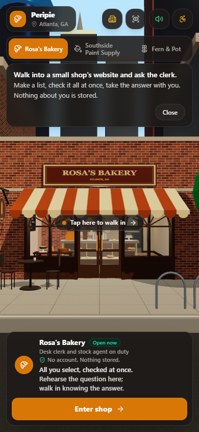

# Peripie


Peripie (say "PAIR-ih-pie") is a small shop's website you walk into: the clerk greets you out loud, checks the stock room, and tells you whether they have what you came for.

## Try it in 60 seconds

**Live:** https://peripie.replit.app (opens on the bakery; sound on). **Domain:** allyou.select, "all you select, checked at once", live and pointing at the same app: https://allyou.select. **Demo video** (3 min): https://youtu.be/IzMbntlPwac. Built solo at HackLanta '26. Submitted on Devpost Sunday at 8:55 am.

1. Tap **Enter shop**, or the doors. The camera walks you in and the clerk says hello out loud.
2. Tap the chip **Do you have sourdough?** The clerk turns to the stock room, then tells you it is on the shelf, and how many.
3. Tap **Do you have croissants?** They are out, so the clerk says when the next tray comes out of the oven.
4. Tap the round **mic** button next to Ask, allow the microphone, and ask for anything ("do you have bread?").
5. Under **What we carry**, tap three or four items, then tap **Check my list**. The clerk checks the whole list at once and answers it in one go, with one line per item under the words. Tap **Take this with you** to share or copy that answer; it ends "via allyou.select". (Merged Sunday about 10:35 am, after the Devpost submission; on the live site from the next republish after that merge.)

What you should see and hear: the label **Checking with the stock room** while the clerk turns to the stock agent, then the answer in the clerk's own voice, and under it a line that starts **Stock room ·** with the count and the restock time, straight from the database.

On a phone: volume up, and the silent switch off on an iPhone. The mic asks for permission once; on an iPhone the words may appear only when you stop talking. If an answer comes back in a plainer voice, that is a fallback, explained below.

What the clerk said on the live site tonight (Sunday 4:15 am, asked from outside, 1.8 s each with audio):

> "We're out of croissants right now. The next tray of croissants comes out of the oven today at 7 am."
>
> "Sure, let me check. We're out of rollers right now, and our supplier's truck comes Friday, October 16."

The oven time is the bakery's own schedule (a tray every 20 minutes, 7 am to 5 pm). Under the roller answer the record reads *usually about 4.5 days*, measured from sixty days of shelf counts.

## Why I built it

I run a painting company. My customers call to ask one thing: do you have it? I don't want them to wait on hold or drive by if the paint isn't there. The virtual-store platforms that exist (Obsess, Emperia) sell to large brands with huge catalogs; nobody serves small local shops like mine. This started because I needed a simple way for my business to answer that question without hiring more staff or buying expensive software.

Some days I'm also the customer who won't ask. I'll order at a drive-through before I'll ask at a counter, and a website can't answer the question anyway. Peripie is a counter you can walk up to from wherever you are. You watch the clerk turn to the stock room before answering, so the answer is one you can trust.

## What it does

1. Pick a shop and tap **Enter shop**. The doors open and the camera walks you to the counter.
   
2. The clerk greets you out loud, in an ElevenLabs voice.
   
3. Ask for a product, by typing or by voice. The clerk turns to the stock agent; the label reads *Checking with the stock room*.
   
4. Hear the answer: in stock and how many, or out and when it is back. Under the clerk's words sits the stock room's own record, and a Replay button.
   
   (Taken Saturday. Since then the bakery answers with its oven schedule instead of a date.)

Beyond those four steps, all of this is on the page too. The last four bullets, the Clerk voice switch, the record line's shop sentence and "2 left", and the nine-item wall board and **What we carry** merged Sunday about 10:35 am, after the Devpost submission; the live site carries them from the next republish after that merge, and the Devpost text describes the 8:55 am state.

- **The stock room's record under every answer** ("Stock room · roller · 0 on hand · Our supplier's truck comes Friday, October 16 · usually about 4.5 days"): the shop's own sentence, "2 left" when stock is low, and the typical days only beside a weekday, never next to an oven time. Why it matters: you see the agent's work, not just the clerk's words.
- **Replay** plays the greeting or the last answer again. Why it matters: loud rooms, and it works from memory, so nothing is stored.
- **The accessibility drawer** (top right): Captions, Larger text, High contrast and Reduce motion, seeded from your phone's own settings and kept for this visit only, and a fifth switch, **Clerk voice**, whose hint reads "Off: the clerk's words are shown, never spoken, for a quiet room". **Describe this view** reads out what is on screen in the browser's own voice, without touching the network. Why it matters: the second audience is people the usual shop website leaves out, and saving these settings would break Zero Data.
- **The mic**: press to talk; typing stays. Why it matters: some people would rather say it than type it, and the browser does the transcribing, so the page only ever sees the words.
- **The paint store's support agent**: ask "which primer for a bathroom?" and you get one practical tip, then the stock of what it recommends. Why it matters: two shops with different staff running from the same code is the platform idea, shown rather than described.
- **Shops that speak in their own words**: the bakery counts loaves and talks about trays and the oven; the paint store about cans and the supplier's truck; the plant shop about the grower and pots. Why it matters: a bakery does not "restock in three days", it bakes, and each time the clerk gives is that shop's real schedule.
- **27 products with aliases**, nine per shop: "bread" finds the sourdough and names the baguette; "two left" when stock is low; a price only when you ask; opening hours; and the clerk says plainly what it cannot do (deliver, hold, take payment). Why it matters: judges ask sideways questions, and "we don't carry that" to "do you have bread?" would end the conversation. The question chips show four per shop; the wall board and **What we carry** list all nine.
- **My list, Check my list, Take this with you**: under **What we carry** you tap what you need (nine items per shop; a tick marks what is on the list), then tap **Check my list**. The page sends the whole list in one request, the clerk turns to the stock room once, and the answer comes back as one spoken summary; under it sits one line per item in the stock room's own words, with the price and "2 left" when stock is low. The list then folds to "3 items checked · Edit list" so it stops covering the clerk. **Take this with you** hands you the answer as plain text through the phone's share sheet, or copies it, ending "via allyou.select". Nothing is stored. Why it matters: my own case is the large order I would rather not ask about three times. You prepare the list in private and walk in knowing the answer. (On a phone, three or four items is the comfortable size; with six to nine the clerk's summary makes the card tall enough to scroll over the clerk.)
- **Follow-up questions**: ask about croissants, then "and the sourdough?", and the clerk knows what you mean. The page keeps the last three exchanges of the visit in memory and sends them with the next question; **Leave shop** clears them. Why it matters: a counter is a conversation, not a row of search boxes, and keeping that memory in the page rather than on the server keeps Zero Data true.
- **The first-visit card and the dock line**: each time the page loads, a card on the street says three things: "Walk into a small shop's website and ask the clerk." "Make a list, check it all at once, take the answer with you." "Nothing about you is stored." Under the shop's name the dock reads "All you select, checked at once." and, in a quieter line, "Rehearse the question here; walk in knowing the answer."; under the input at the counter: "Take your time. No one is waiting behind you." Why it matters: the dock line is what the domain means. allyou.select is the list, all you select, checked at once, and the card tells a new visitor what this place is before they tap anything. The quiet lines are for the visitor who finds counters hard, which some days is me.
- **Each shop its own storefront and counter**: Rosa's is brick, with an arch over each window and a deep striped awning, and inside the counter is a glass pastry case; Southside Paint Supply has a flat industrial front with a steel window grid and a pyramid of gallons in the window, and a mixing bench for a counter; Fern & Pot is a greenhouse, glass panels and a glass gable, with a fern and a snake plant on the pavement and a potting bench inside. The clerk and the stock agent are dressed for their shop (a toque at the bakery, a straw hat on the plant shop's stock agent), with a small smile and a slow breath while they wait; the STOCK ROOM plate hangs beside its door, and the hours card says what the clerk says: 7 am to 5 pm at the bakery, 8 am to 6 pm at the paint store, 9 am to 6 pm at the plant shop.
  
  Why it matters: the sandbox pitch only lands if the three shops look like three places an owner could have made, not one template in three colours.

## After the submission

The Devpost text went in at 8:55 am Sunday and describes the live site as it was then: the list, the hands-free guide, follow-up questions and the second visual pass were built on the server but not on the live page. At 9:37 am the live site was republished from main as it stood at the submission. At about 10:35 am, after the submission, the page halves of the list and the nine-item **What we carry**, the record line in the shop's own words with "2 left" when stock is low, the follow-up questions, the first-visit card and the second visual pass merged into main; the live site carries them from the next republish after that merge. This README describes that later state and says so where those features are listed. The Devpost text keeps the 8:55 am state.

What did not make the cut:

- **The hands-free guide's page half.** The Hands-free switch and the spoken commands (enter the bakery, turn on captions, describe the view) were not built. The server half is live: `POST /api/guide` answers with 28 cached phrases in a second ElevenLabs voice, chosen by `GUIDE_VOICE_ID` in the table below. It is listed here so no one goes looking for it on the page.

## How it works

The diagram, drawn for shop owners first: [who talks to whom](docs/architecture.md). Also [one question, step by step](docs/sequence.md), [a visit to the shop](docs/user-flow.md) and [the two tables](docs/data-model.md).

- The clerk is a Gemini model with one tool, `check_stock`, and its first move on every question is forced to be that call (function-calling mode ANY), so the clerk cannot make stock up; it can only word what the stock room returned.
- The stock room is a Postgres table on Tiger Data with sixty days of shelf counts per product, and a `LAG` window over those counts finds each spell at zero, so "usually about 4.5 days" is measured from history, not guessed. Node turns the date into "Friday, October 16", so the model never does calendar math.
- If both model attempts fail or time out but the lookup found the product, the server composes the answer from the stock record itself, so a bad minute for the model still gives a correct answer, in the real voice.
- The voice is one plain `fetch` to ElevenLabs (its SDK's 72 MB import froze a cold start for up to 48 s), and the three greetings are voiced at boot and kept in memory, so the first visitor hears the voice too, and no audio file is ever written.

Timing: the page waits 15 s, the model gets 10 s, and the voice gets what is left before 12.5 s, so every reply is back before the page gives up. The storefront is Three.js in one HTML file with no build step, served by the app itself.

## What's real and what's a fallback

**Real, on every question:** Gemini words the answer (`gemini-3.5-flash-lite`, with `gemini-3.8-flash` as the second try), ElevenLabs voices it, and the stock lookup runs against Tiger Data. The greeting is fixed text per shop, voiced once by ElevenLabs and kept in memory; no model is involved. The stock itself is seeded for the demo: three shops, 27 products, 240 counts each.

**The fallbacks, in order:**

1. The model fails, hangs or is rate-limited (the free key allows about six questions a minute), but the lookup found the product: the server answers from the record in plainer words, still in the ElevenLabs voice.
2. ElevenLabs fails or runs out of time: the same words in the browser's own voice.
3. Tiger Data cannot be reached: the stock room reads a built-in copy of the same seed, so the facts do not change.
4. The server cannot be reached, or the model is down and nothing matched: the page answers from its printed list, which now carries all 27 products, nine per shop, in the browser's voice, and says so under the answer. A list gets the printed list's line for each item.

**Stored about you:** nothing. The street card says it: No account. Nothing stored. No cookie of ours, no local storage, no analytics, no third-party script; the 3D library is served by the app itself. The server log holds method, path, status and milliseconds, never the question or the reply.

**What each outside service receives:** Gemini gets your words (on the free tier, Google may use them to improve its products). ElevenLabs gets only the clerk's reply, never your question, and keeps replies in the account's history. Tiger Data gets only the shop id; the product is matched in Node. The mic's audio goes to Google (Chrome) or Apple (Safari) for transcribing; the page sees only the words. The host, Replit, counts requests and unique IPs and keeps deployment logs for 30 days, and Google's front end, which it runs behind, sets one routing cookie (`GAESA`) on every app it serves; it carries no identity and we never read it. Replit's analytics add-on injects a script when it is on, so it stays off.

## Built with

| | Role in Peripie |
|---|---|
| **Gemini API** | The clerk: understands the question and words the answer. Its first move is always the `check_stock` call. |
| **ElevenLabs** | The clerk's voice: each reply comes back as an mp3 inside the JSON; greetings are voiced once and cached. |
| **Tiger Data** | The stock room: Postgres with a `stock_events` hypertable, sixty days of counts per product; "usually about N days" is computed from it at lookup time. |
| **Replit** | Hosts the Node + Express server and the page at a public https URL. |

Entered: the AI/ML track (two agents with a visible hand-off that take a real task off a shop owner's plate); the Replit "Small Business" challenge; Best Use of ElevenLabs (the voice is the product); Best Use of Gemini API (Gemini runs the clerk and decides when to call the stock tool); Best Use of Tiger Data (restock history as time-series data, used in the answers); the Zero Data challenge (no accounts, tracking, profiles or stored personal data); GoDaddy Registry (allyou.select, registered at HackLanta and live, pointing at the same app).

## Built in a weekend

One person, one plan. [PLAN.md](PLAN.md) fixed the API contract first; four Claude Code agents then built against it by role (backend, data, frontend, and a staff engineer that reviewed at four checkpoints and owns the contract). A local Ollama drafted the docs and the pitch, and every SDK call was checked against the current docs before it was written. The idea log, with what was dropped and why: [docs/decisions.md](docs/decisions.md).

### Challenges

- On the first real run `gemini-3.8-flash` answered 503 to every call, then 429, and a hang ate the whole 10 s budget. Fix: `gemini-3.5-flash-lite` first (about a second per answer), 3.8-flash second, and a 5 s cap on each attempt.
- A 12 s page timeout against a 12 s server deadline was a tie a slow real answer would lose. The budget is now 15 s for the page, 10 s for the model, and the voice gets the time left before 12.5 s.
- iOS Safari silences audio that does not start inside the tap, so one shared Audio element is primed in the Enter handler and reused for every reply.
- Replit names its own Postgres `DATABASE_URL`, so the live app could have quietly answered from the built-in seed. The server reads `TIGER_DATABASE_URL` first and logs which database it uses.
- At 3 am Replit's Agent rewrote the workspace and a republish rolled the site back; the fix was a clean re-import of `main` into a new Repl.

### What I learned

- Force the tool call. "Always check stock" in a prompt is a suggestion; `functionCallingConfig.mode = ANY` on the first round is a rule.
- Put the weekday in the tool result, not in the prompt. The model should never do calendar math.
- Fallbacks are what let you demo at all at a venue; the canned answers and the browser voice were in the page from the first commit.
- A bakery does not "restock in three days"; it bakes. A schedule per item made the answers sound like the shop.

### What's next

The sandbox builder: owners assemble their own shop from ready-made elements and staff it with agents, a free shop with one clerk and paid add-on agents. Each shop is already one settings file (tap the Peripie card, top left, to see it); the builder lets an owner edit it by dragging things around. After that: a photo of the real storefront for the sign and walls, checkout, and the clerk running on the shop's own hardware.

## Run it locally

```bash
npm install
cp .env.example .env     # fill in the keys below
npm start                # http://localhost:3000
```

| Variable | What it is |
|---|---|
| `GEMINI_API_KEY` | Google AI Studio key |
| `GEMINI_MODEL` | optional; default `gemini-3.5-flash-lite` |
| `ELEVENLABS_API_KEY` | ElevenLabs key |
| `ELEVENLABS_VOICE_ID` | optional; defaults to their "George" voice |
| `GUIDE_VOICE_ID` | optional; the hands-free guide's voice, defaults to their "Sarah" voice |
| `TIGER_DATABASE_URL` | Tiger Data connection string, ending in `?sslmode=require` |

Load the schema and seed with the commands in [db/README.md](db/README.md). Without any of the keys the server still starts: questions get the page's canned answers, the voice is the browser's, and stock comes from the built-in copy of the seed.
