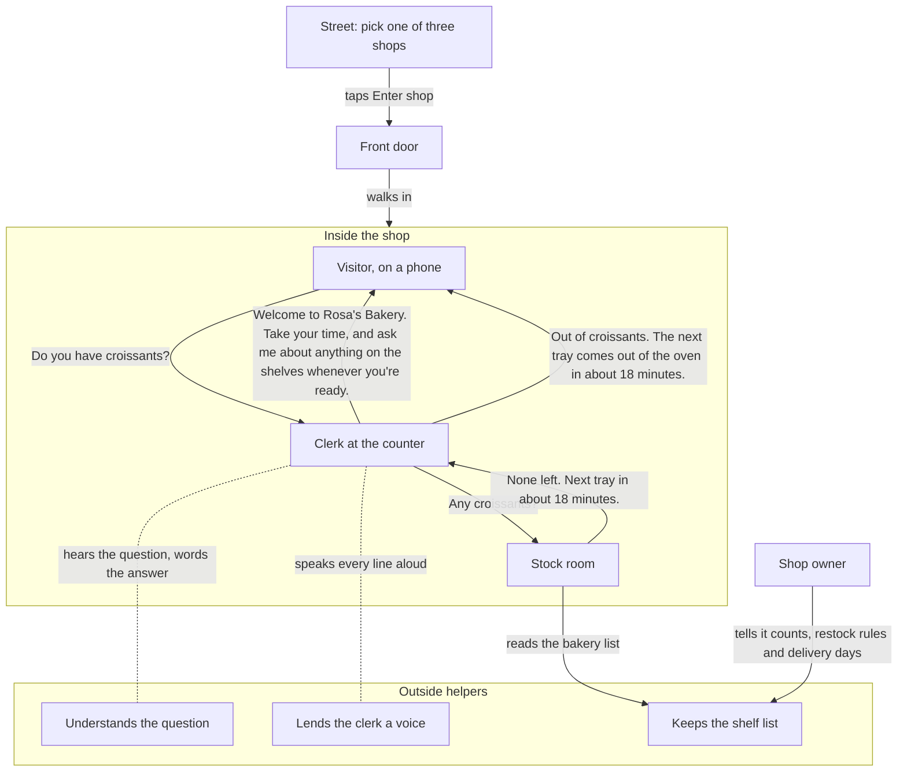

# Architecture

Peripie is a small shop's website that you walk into. A clerk greets you out loud, and when you ask for something, the clerk checks the stock room before answering. It takes one job off the owner's plate: answering "do you have it?"

This page shows who talks to whom, first as people and places, then as files and services.

## The shop

- **The street.** One shopfront at a time, with three shops to pick from: Rosa's Bakery, Southside Paint Supply and Fern & Pot. On a first visit a card says in three lines what this place is and that nothing about you is stored. The visitor picks one and taps Enter shop.
- **The door.** The doors open and the visitor walks to the counter. The clerk gets the greeting ready on the way in: one fixed line per shop, voiced once and kept in memory, never sent to the helper who understands questions. Leave shop walks the visitor back out.
- **The counter.** The clerk greets the visitor out loud. The visitor types a question, and the clerk answers out loud in one or two short sentences.
- **The stock room.** The clerk checks here before every answer. On screen, the clerk turns to a stock agent and the status reads "Checking with the stock room".
- **The shelf list.** The owner's record for each product: how many are on hand, how and when more comes (a tray every 20 minutes, the supplier's truck on Fridays) in the shop's own words, and past counts that show how long it usually takes to come back.
- **Outside helpers.** The shop uses three: one understands the question and words the answer, one lends the clerk a voice, and one keeps the shelf list and the count log.

## Who talks to whom



Solid arrows are things said, tapped or looked up during one visit, except the owner's, which happens outside any visit. Dotted lines are outside help.

The clerk has to check the stock room before it answers. Stock comes from the shelf list, not from memory.

Each helper hears only what it needs. The helper who understands hears the question. The voice hears only the clerk's words. The shelf list keeper hears only which shop is asking, and the stock room finds the item itself.

The shop keeps nothing about the visitor: no account, no cookie, no copy of what they asked.

The helpers are a different matter, and the plan says so plainly: on its free tier, the helper who understands the question may keep it to improve its own products; the voice service keeps the clerk's lines, never the question, in its history; and the host counts visits by country. None of them gets a name, an account or a cookie. The full disclosure is in [PLAN.md section 4](../PLAN.md#4-rules-for-everyone).

In the demo, the shelf list is sample data: nine products in each shop, 27 in all, with 60 days of past counts. The owner has no screen for it.

If something is slow or down, the visit still works:

- **The helper who understands is down, but the stock room found the item:** the clerk says the record in plainer words, still in its own voice.
- **No answer within 15 seconds, or the helper is down and nothing matched:** the clerk answers from the printed list built into the page, all 27 products with rougher times, in the phone's own voice.
- **The voice fails or is late:** the phone's own voice says the same words.
- **The shelf list keeper cannot be reached:** the stock room reads a built-in copy of the sample list.

## For engineers: the same shop in code

| In the story | File | Outside service |
|---|---|---|
| Street, front door, counter, clerk and stock agent on screen | `public/index.html`, a Three.js scene; the library is served by the app itself from `public/vendor/three-0.186.1/` | none |
| Clerk taking the question and handing back the answer | `server/index.js`: `POST /api/clerk` on Express | none |
| Understands the question | `server/clerk.js` | Gemini API, with `check_stock` as its only tool |
| Stock room | `server/stock.js`: `check_stock` | none |
| Keeps the shelf list | `db/schema.sql`, `db/seed.sql` | Tiger Data (Postgres): `inventory`, `stock_events` |
| The owner's counts, rules and notes, in the demo | `db/seed-data.js`: sample data that generates `db/seed.sql` and is the built-in copy | none |
| Lends the clerk a voice | `server/voice.js` | ElevenLabs text to speech, sent back as an mp3 data URL |
| Backup answers and the phone's own voice | `public/index.html` | none: the browser's built-in speech |

One question, step by step: [sequence.md](sequence.md). The tables behind the shelf list: [data-model.md](data-model.md).

## Request contract

**Question:**
```json
{ "shop": "bakery", "text": "do you have croissants?" }
```
A question may also carry `history`, up to three prior `{ "q", "a" }` pairs, and `{ "shop", "items" }` checks a whole list of 1 to 12 items in one request (PLAN.md section 3). The page sends both: `history` with every question after the first (Leave shop clears it), and `items` when the visitor taps Check my list.

**Greeting:**
```json
{ "shop": "bakery", "greet": true }
```

**Response:**
```json
{
  "reply": "We're out of croissants right now. The next tray of croissants comes out of the oven in about 18 minutes.",
  "audioUrl": "data:audio/mpeg;base64,...",
  "stock": { "product": "croissant", "inStock": false, "onHand": 0, "nextRestock": "2026-10-11",
             "nextRestockText": "in about 18 minutes", "typicalRestockDays": 3,
             "restockNote": "The next tray of croissants comes out of the oven in about 18 minutes.",
             "nextRestockAt": "2026-10-11T09:20:00-04:00", "price": "$4.00", "lowStock": false, "alsoMatched": [] }
}
```
