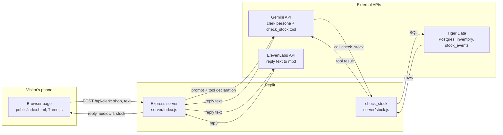

# Architecture

Peripie is a small shop's website that simulates a walk-in experience. The visitor sees the storefront from the street, the camera moves through the door, and a clerk at the counter greets them out loud. The visitor asks for a product, the clerk checks with a stock agent, and answers by voice: in stock, or out of stock and back on a given date.



The server keeps no state between requests and never writes the visitor's text anywhere; the only stored data is the shops' inventory and restock history.

| File | Responsibility |
|------|----------------|
| `server/index.js` | Express app, /api/clerk |
| `server/clerk.js` | Gemini call and tool loop |
| `server/stock.js` | check_stock and SQL |
| `server/voice.js` | ElevenLabs call |

## Request contract

**Question:**
```json
{ "shop": "bakery", "text": "do you have croissants?" }
```

**Greeting:**
```json
{ "shop": "bakery", "greet": true }
```

**Response:**
```json
{
  "reply": "We're out of croissants right now. They'll be back Tuesday, October 13.",
  "audioUrl": "data:audio/mpeg;base64,...",
  "stock": { "product": "croissant", "inStock": false, "onHand": 0, "nextRestock": "2026-10-13",
             "nextRestockText": "Tuesday, October 13", "typicalRestockDays": 3 }
}
```
