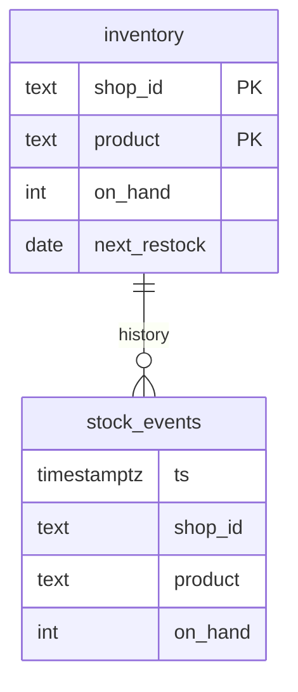

# Data model

Tiger Data is Postgres with time-series features; stock_events is a hypertable partitioned on ts.

`inventory` has a composite primary key `(shop_id, product)`. `stock_events` is a hypertable partitioned on `ts` and has no primary key: a unique index on a hypertable must include the time column, so the table carries a plain index on `(shop_id, product, ts)` instead. The relationship above is by `(shop_id, product)`, not a foreign key.

| Table       | Column          | Type    | Meaning                          |
|-------------|-----------------|---------|----------------------------------|
| inventory   | shop_id         | text    | Shop id (bakery, paint, plants); part of the primary key |
| inventory   | product         | text    | Product name; part of the primary key |
| inventory   | on_hand         | int     | Current stock level              |
| inventory   | next_restock    | date    | Next restock date                |
| stock_events| ts              | timestamptz | Timestamp of stock event     |
| stock_events| shop_id         | text    | Shop identifier                  |
| stock_events| product         | text    | Product name                     |
| stock_events| on_hand         | int     | Stock level at the timestamp     |

## How typicalRestockDays is computed

The `stock_events` table is scanned per `(shop_id, product)` in time order. The `LAG(on_hand)` function is used to find each transition from 0 to a positive number, indicating a restock. The gap in days from the first zero to the restock is averaged. The result is `null` when the item has never hit zero.

## Seed data

Three shops (bakery, paint, plants) are seeded with products matching the page's `SHOPS` list. Each product has about 60 days of `stock_events` per product, and `next_restock` is seeded relative to `current_date` so it stays in the future.
