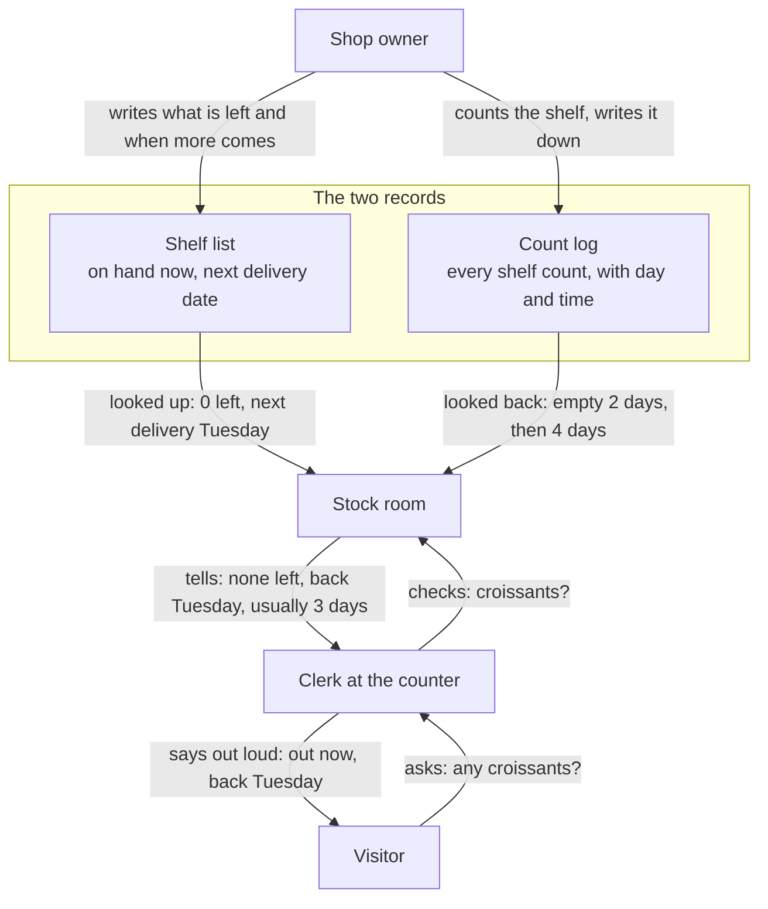
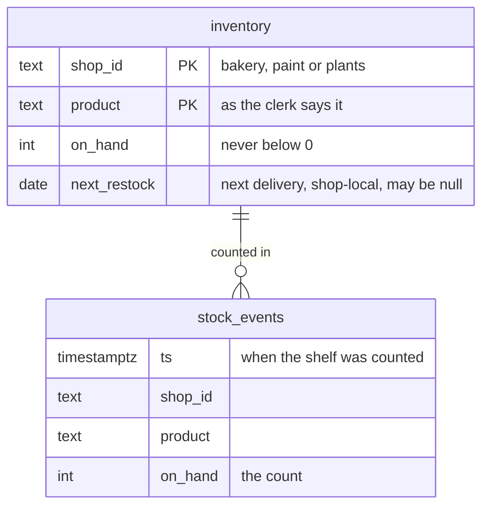

# Data model

Peripie keeps two records. They are the same two a shop owner already keeps on paper today.

- **The shelf list.** One line per product: how many are on hand, and when the next delivery is due.
- **The count log.** One line each time someone counts a shelf: the day and time, the product, the count. A delivery shows up as the count going back up.

## Who writes them, who reads them



The owner writes both records. A visitor's question goes up to the stock room, which only reads them, and the answer comes back down. In the demo, both records hold sample data, loaded ahead of time.

The shop keeps nothing about the visitor: neither record has a place for who asked or what they said.

## The shelf list

Rosa's Bakery, as loaded on Saturday, October 10:

| Product | On hand | Next delivery |
|---|---|---|
| sourdough | 8 | Sunday, October 11 |
| croissant | 0 | Tuesday, October 13 |
| concha | 10 | Sunday, October 11 |
| baguette | 0 | Sunday, October 11 |

Southside Paint Supply and Fern & Pot keep the same kind of list, four products each. The paint store gets deliveries on Fridays, the plant shop on Saturdays.

The list is dated relative to the day it is loaded, so a load on another day shifts these dates.

## Usually back in about three days

Typical restock days is how many days the shelf usually stays empty before it is filled again.

The shelf list cannot answer that, because it only knows today. The count log can, because it remembers.

The croissant, from the same Saturday list:

| Shelf went empty | Filled again | Days empty |
|---|---|---|
| Monday, August 24 | Wednesday, August 26 | 2 |
| Friday, September 18 | Tuesday, September 22 | 4 |
| Friday, October 9 | Not yet: due Tuesday, October 13 | Not counted until it is filled |

Two empty spells have ended: 2 days and 4 days. The average is 3, so the clerk may add that croissants usually come back within about three days.

Nobody writes the 3 down. It is worked out from the count log when someone asks. The dates shift with the list; the 3 does not.

The concha (bakery) and the terracotta pot (plant shop) have never run out. They have no number, and the clerk does not mention one.

## For engineers: the same two records as tables

Both tables live in Tiger Data (Postgres with TimescaleDB). The full request path is in [architecture.md](architecture.md) and [sequence.md](sequence.md).

| In the story | In the code |
|---|---|
| Shelf list | `inventory`: one row per shop and product |
| Count log | `stock_events`: one row per count, a hypertable partitioned on `ts` |
| Stock room | `checkStock(shopId, query)` in `server/stock.js`, run when Gemini calls the `check_stock` tool |
| What the clerk answers | Gemini, prompted in `server/clerk.js`; the page's own canned answers if that fails. The greeting is fixed text per shop, never Gemini |
| Saying it out loud | ElevenLabs in `server/voice.js`; the browser's own voice if that fails |
| Usually back in about 3 days | `typicalRestockDays`, computed from `stock_events` at lookup time, not stored |
| The owner filling in both records | Sample data: `db/seed.sql`, generated from `db/seed-data.js` |



`inventory` has a composite primary key `(shop_id, product)`. `stock_events` has no primary key: any unique index on a hypertable must include the time column, and nothing needs one. It has a plain index on `(shop_id, product, ts)` instead. The tables match on `(shop_id, product)`; there is no foreign key.

`checkStock` runs one query per lookup: the shop's `inventory` rows, left-joined to restock gaps from the last 90 days of `stock_events`. The 90-day bound lets TimescaleDB skip older chunks.

`LAG(on_hand)` over each product in `ts` order marks every count above 0 that follows a 0: a restock. Its gap runs from the first 0 of that empty spell. The average gap in days, rounded to one decimal, is `typicalRestockDays`. It is null when no empty spell has ended.

What the stock room hands the clerk for the croissant:

```json
{ "found": true, "product": "croissant", "inStock": false, "onHand": 0, "nextRestock": "2026-10-13",
  "nextRestockText": "Tuesday, October 13", "typicalRestockDays": 3 }
```

`nextRestockText` is written in Node, in America/New_York, so the clerk never works out a weekday.

The visitor's words never reach the database. The only query parameter is the shop id, and the product is matched in Node. What Gemini and ElevenLabs receive is listed in [PLAN.md section 4](../PLAN.md#4-rules-for-everyone).

Sample data: three shops with four products each, matching `SHOPS` in `public/index.html`. One count every 6 hours for 60 days: 240 rows per product, 2,880 in all. `db/seed-data.js` feeds both `db/seed.sql` and the in-memory copy that `server/stock.js` answers from when `DATABASE_URL` is unset or the database is down. Loading steps are in [db/README.md](../db/README.md).
