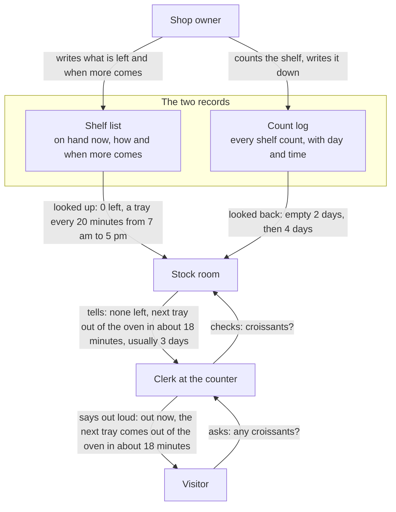
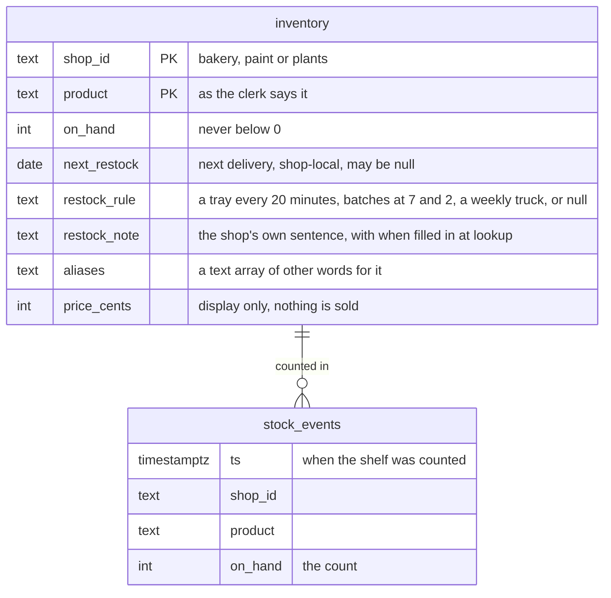

# Data model

Peripie keeps two records. They are the same two a shop owner already keeps on paper today.

- **The shelf list.** One line per product: how many are on hand, how and when more comes (a tray every 20 minutes, the supplier's truck on Fridays), the shop's own sentence about it, the other words people use for it, and the price.
- **The count log.** One line each time someone counts a shelf: the day and time, the product, the count. A delivery shows up as the count going back up.

## Who writes them, who reads them



The owner writes both records. A visitor's question goes up to the stock room, which only reads them, and the answer comes back down. The stock room hands the clerk everything it found; the clerk says the oven time and keeps the 3 days to itself, for a reason given below. In the demo, both records hold sample data, loaded ahead of time.

The shop keeps nothing about the visitor: neither record has a place for who asked or what they said.

## The shelf list

Rosa's Bakery, as loaded on Sunday, October 11:

| Product | On hand | Next | The shop's own line |
|---|---|---|---|
| sourdough | 8 | tomorrow, baked daily | Baked fresh this morning. |
| croissant | 0 | a tray every 20 minutes, 7 am to 5 pm | The next tray of croissants comes out of the oven {when}. |
| concha | 10 | tomorrow, baked daily | Baked fresh this morning. |
| baguette | 0 | batches at 7 am and 2 pm | We bake baguettes at seven and at two; the next batch is {when}. |
| gluten-free loaf | 2, running low | Sunday, October 18 | We bake a small batch of gluten-free loaves on Sundays; there are two left today. |
| cinnamon roll | 6 | tomorrow, baked daily | |
| pan de muerto | 0 | a batch at 7 am every day | We bake pan de muerto in the morning; the next batch is {when}. |
| coffee | 60 | tomorrow | |
| birthday cake | 0 | made to order, two days out | Cakes are made to order; the next one we can do is {when}. |

The stock room fills in {when} from the clock before the clerk sees the line: "in about 18 minutes", "today at 2 pm", "tomorrow at 7 am", or a day such as "Tuesday, October 13".

Southside Paint Supply and Fern & Pot keep the same kind of list, nine products each. The paint store's supplier truck comes on Fridays, the plant shop's grower on Saturdays. Every product also carries the other words people use for it (bread or loaf for the sourdough, pot for the terracotta pot) and a price, which the clerk says only when asked.

The dates are relative to the day the list is loaded, so a load on another day shifts them. The rules do not shift: a tray every 20 minutes is true on any day.

## Usually back in about 4.5 days

Typical restock days is how many days the shelf usually stays empty before it is filled again.

The shelf list cannot answer that, because it only knows today. The count log can, because it remembers.

The paint roller, from Southside Paint Supply's list on the same Sunday:

| Shelf went empty | Filled again | Days empty |
|---|---|---|
| Friday, August 28 | Wednesday, September 2 | 5 |
| Monday, September 21 | Friday, September 25 | 4 |
| Friday, October 9 | Not yet: the supplier's truck comes Friday, October 16 | Not counted until it is filled |

Two empty spells have ended: 5 days and 4 days. The average is 4.5, so the clerk may add that rollers usually come back within about four and a half days. Under the answer, the record reads "usually about 4.5 days".

Nobody writes the 4.5 down. It is worked out from the count log when someone asks. The dates shift with the list; the 4.5 does not.

The clerk says that number only next to a day, like the truck's Friday. The bakery's croissant has a number too (empty 2 days once and 4 days once, so 3), but its time is the next tray, "in about 18 minutes", and "usually about 3 days" next to that would contradict the oven. The counts are also taken every 6 hours, too coarse for a tray every 20 minutes. So for a time in minutes, today or tomorrow, the clerk leaves the number out.

The concha and the coffee (bakery), the sandpaper (paint store), the terracotta pot and the succulent (plant shop) have never run out. They have no number, and the clerk does not mention one.

## For engineers: the same two records as tables

Both tables live in Tiger Data (Postgres with TimescaleDB). The full request path is in [architecture.md](architecture.md) and [sequence.md](sequence.md).

| In the story | In the code |
|---|---|
| Shelf list | `inventory`: one row per shop and product, with its restock rule, the shop's sentence, aliases and price |
| How and when more comes | `restock_rule` and `restock_note` on the `inventory` row, turned into `nextRestockText` and `restockNote` in `server/stock.js` |
| Count log | `stock_events`: one row per count, a hypertable partitioned on `ts` |
| Stock room | `checkStock(shopId, query)` in `server/stock.js`, run when Gemini calls the `check_stock` tool |
| What the clerk answers | Gemini, prompted in `server/clerk.js`; the record worded by `server/template.js` if no model answers; the page's own canned answers if the server cannot be reached. The greeting is fixed text per shop, never Gemini |
| Saying it out loud | ElevenLabs in `server/voice.js`; the browser's own voice if that fails |
| Usually back in about 4.5 days | `typicalRestockDays`, computed from `stock_events` at lookup time, not stored; said only beside a weekday time |
| The owner filling in both records | Sample data: `db/seed.sql`, generated from `db/seed-data.js` |



`inventory` has a composite primary key `(shop_id, product)`. `stock_events` has no primary key: any unique index on a hypertable must include the time column, and nothing needs one. It has a plain index on `(shop_id, product, ts)` instead. The tables match on `(shop_id, product)`; there is no foreign key.

`checkStock` runs one query per lookup: the shop's `inventory` rows, left-joined to restock gaps from the last 90 days of `stock_events`. The 90-day bound lets TimescaleDB skip older chunks. A list is one such query for all its items.

`LAG(on_hand)` over each product in `ts` order marks every count above 0 that follows a 0: a restock. Its gap runs from the first 0 of that empty spell. The average gap in days, rounded to one decimal, is `typicalRestockDays`. It is null when no empty spell has ended.

What the stock room hands the clerk for the croissant:

```json
{ "found": true, "product": "croissant", "inStock": false, "onHand": 0, "lowStock": false, "price": "$4.00",
  "nextRestock": "2026-10-11", "nextRestockAt": "2026-10-11T09:20:00-04:00", "nextRestockText": "in about 18 minutes",
  "restockNote": "The next tray of croissants comes out of the oven in about 18 minutes.",
  "typicalRestockDays": 3, "alsoMatched": [] }
```

`nextRestockText` is written in Node, in America/New_York, from the row's `restock_rule` and the clock, so the clerk never works out a weekday or a minute count: within 90 minutes "in about 18 minutes", later today "today at 2 pm", "tomorrow at 7 am", and otherwise, or when only the date is known, "Friday, October 16". `restockNote` is the row's `restock_note` with `{when}` filled in from it. `lowStock` is true at 1 to 3 on hand, `price` is shown only when asked, and `alsoMatched` names the other products the visitor's words fit.

The visitor's words never reach the database. The only query parameter is the shop id, and the product is matched in Node, by name and by alias. What Gemini and ElevenLabs receive is listed in [PLAN.md section 4](../PLAN.md#4-rules-for-everyone).

Sample data: three shops with nine products each, 27 in all; the first four of each shop are the ones in `SHOPS` in `public/index.html`. One count every 6 hours for 60 days: 240 rows per product, 6,480 in all. `db/seed-data.js` feeds both `db/seed.sql` and the in-memory copy that `server/stock.js` answers from when neither `TIGER_DATABASE_URL` (read first) nor `DATABASE_URL` is set, or the database is down. Loading steps are in [db/README.md](../db/README.md).
