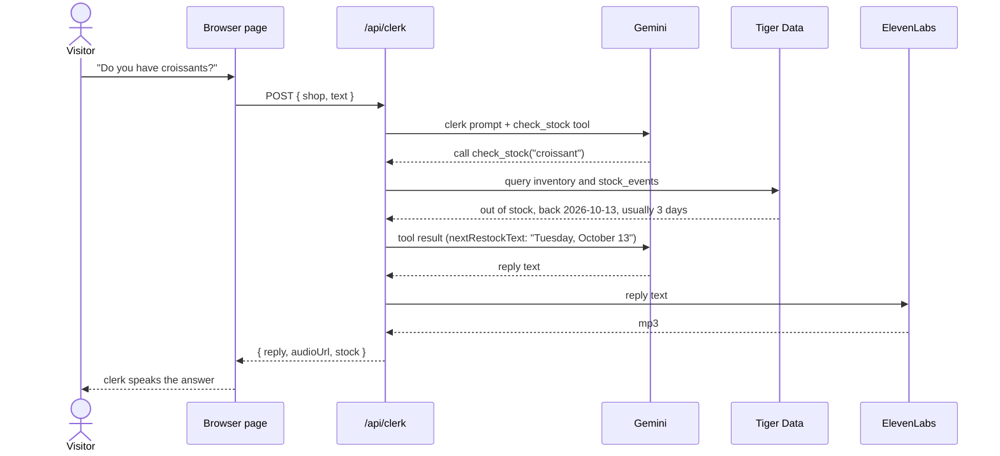
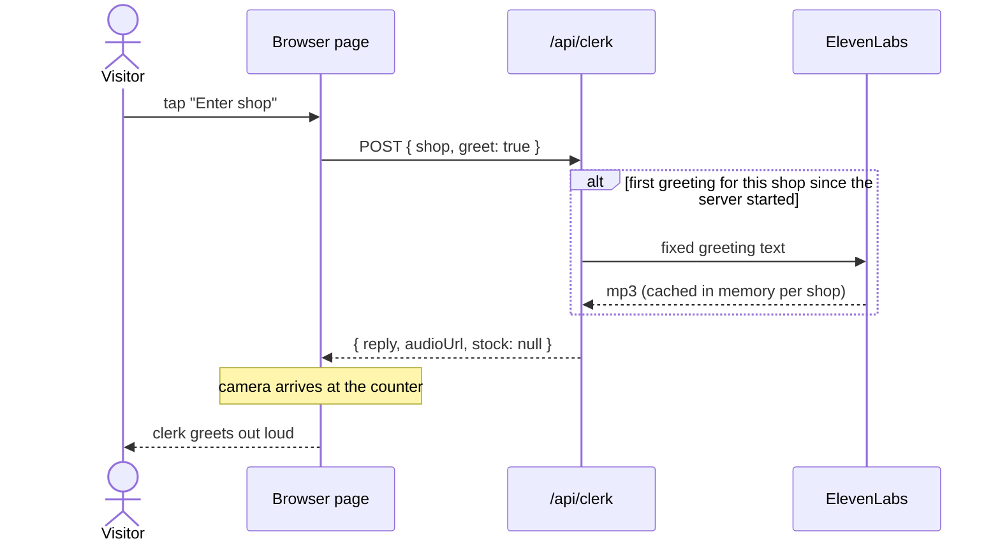

# One question, start to finish

What happens between the visitor's words and the clerk's spoken answer. Two round trips to Gemini (one to decide on the tool call, one to phrase the answer), one query to Tiger Data, one call to ElevenLabs. The server keeps nothing afterwards.

## The greeting

The greeting never touches Gemini. The page asks for it the moment the visitor taps Enter, while the camera is still walking through the door, so the audio is ready at the counter.

## When something fails

| Failure | What the visitor gets |
|---|---|
| ElevenLabs down or out of credits | The same reply, spoken by the browser's own voice (`audioUrl: null`) |
| Gemini down or slower than 12 s | HTTP 502; the page answers from its built-in inventory list with the browser voice |
| No network at all | The page answers from its built-in inventory list with the browser voice |

Nothing about the visitor is stored at any step. See the Zero Data statement in the README.
