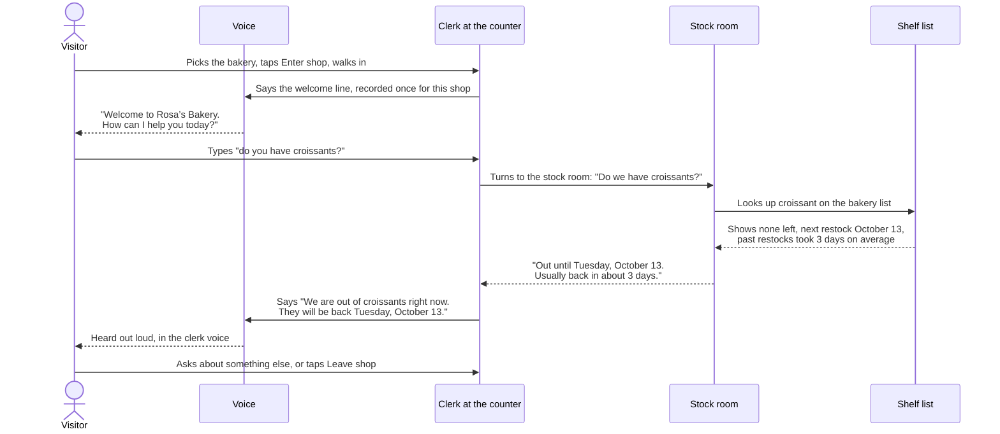
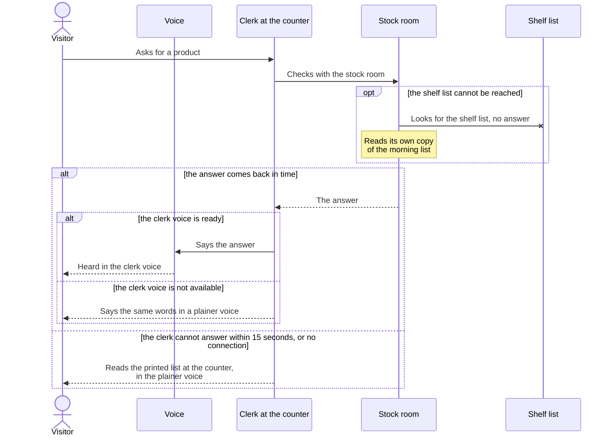
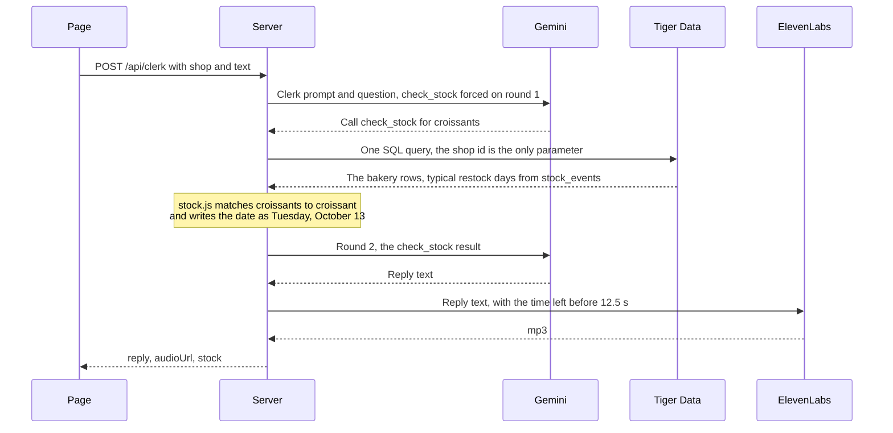

# One question at the counter

A shop owner hears one question all day: do you have it? This doc follows that question through the shop, the way the people in it see it. The code and services are at the bottom, for engineers.

## At the counter

The visitor walks in and the clerk says hello. The visitor types a question. The clerk turns to the stock room, the stock room reads the shelf list, and the clerk says the answer out loud.

While the clerk checks, someone from the stock room appears behind the counter and the screen reads "Checking with the stock room".

The clerk never answers from memory. Every question goes to the stock room first, even a plain "hello".

The stock room reads loosely: "croissants" finds croissant. If the shop does not carry something, the clerk says so and names what is in stock.

The welcome line is recorded once per shop and replayed for every visitor. The clerk gets it ready while the visitor walks in.

The shop keeps nothing about the visitor: no account, no cookies, no record of the question.

## When something goes wrong

The visitor always gets an answer, and waits 15 seconds at most.

- **The clerk voice is not available.** Same words, in a plainer voice: the one built into the visitor's phone or browser. The words are on screen either way.
- **No answer in time, or no connection.** The clerk reads a short printed list kept at the counter, in the plainer voice. Its dates are rougher, like "Tuesday morning".
- **The shelf list cannot be reached.** The stock room reads its own copy of the morning list. The answer sounds the same.
- **The welcome is not ready.** Two seconds after the visitor reaches the counter, the clerk says the same line in the plainer voice.

## Behind the counter

Each person and place above is one part of the code.

| In the shop | In the code |
|---|---|
| Visitor | The page in their browser: `public/index.html`, a Three.js scene |
| Clerk at the counter | Gemini with one tool, run by `server/clerk.js` behind `POST /api/clerk` in `server/index.js` |
| Stock room | The stock agent: `check_stock` in `server/stock.js` |
| Shelf list | Tiger Data: the `inventory` table and the `stock_events` hypertable, 60 days of stock counts |
| Voice | ElevenLabs, through `server/voice.js`; the mp3 comes back as a data URL |
| Welcome line | `{ shop, greet: true }`: fixed text per shop, no Gemini; the mp3 is kept in server memory per shop |
| Plainer voice | The browser's built-in speech, used when `audioUrl` is null or the mp3 will not play |
| Printed list at the counter | The canned answers in `SHOPS` in `public/index.html` |
| Copy of the morning list | The built-in seed in `db/seed-data.js`, rebuilt each day; used when `TIGER_DATABASE_URL` is unset or the database cannot be reached |

## The same question, for engineers

- **Timing (PLAN.md section 3).** The page waits 15 s. The Gemini loop gets 10 s; if it fails or runs out, the server answers 502 `clerk_unavailable`. ElevenLabs gets only the time left before 12.5 s, from 1.5 s to 6 s, or `audioUrl` is null. A 200 leaves by about 12.5 s.
- **Tool rounds.** Round 1 must call `check_stock`. At most two tool rounds, then a round that must answer in words. If the main model fails, the fallback model gets what is left of the 10 s.
- **The greeting** skips Gemini. The page asks for it on the Enter tap and waits up to 2 s past the walk-in.
- **What each service sees.** Gemini gets the question. Tiger Data gets only the shop id. ElevenLabs gets only the clerk's reply. Server logs hold method, path, status, milliseconds and error types.
