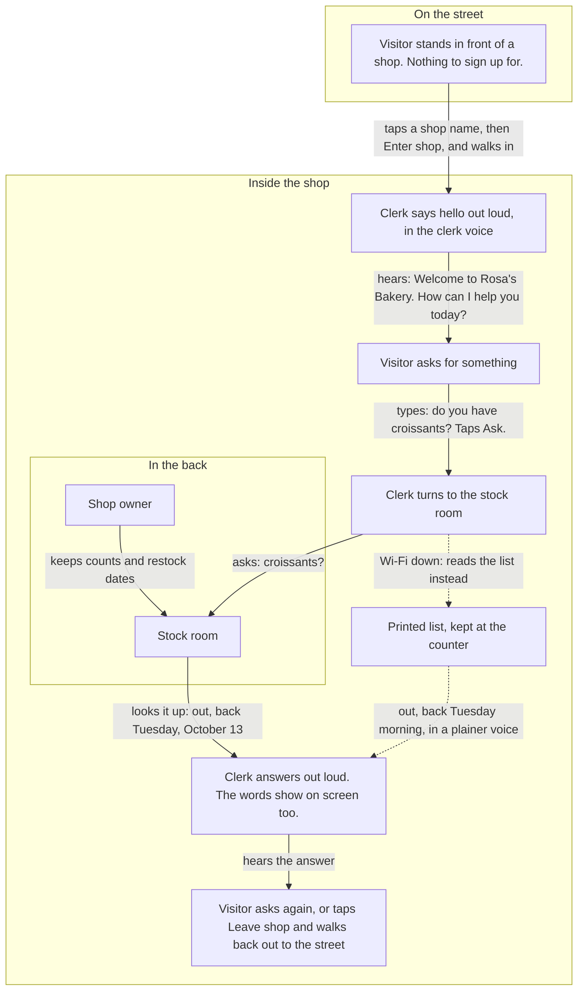
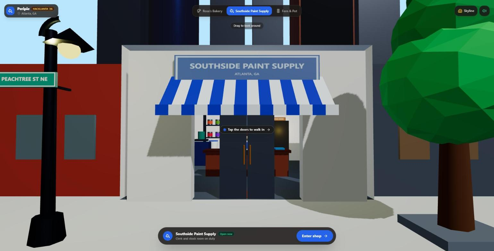

# A visit to the shop

One visit, as the visitor sees it: where you stand, what you tap, what you hear. The machinery behind each step is in the last section, for engineers.

The solid path is a normal visit. The dotted path is what happens when the connection drops after the page has loaded, or when the clerk cannot answer in time.

## Step by step

1. **On the street.** You see a shop front and the names of three shops: Rosa's Bakery, Southside Paint Supply and Fern & Pot. Tap a name to switch shops.
2. **Through the door.** Tap **Enter shop**. The view walks you up to the door, the doors slide open, and you stop in front of the counter.
3. **The greeting.** The clerk says out loud, "Welcome to Rosa's Bakery. How can I help you today?" The words also appear on screen.
4. **Asking.** Type into the **Ask for a product** box and tap **Ask**, or tap the mic button and speak (the mic appears on the https link, not on a plain http address).
5. **The clerk checks.** The label changes to **Checking with the stock room**. The clerk turns away, and a second person appears in the back.
6. **The answer.** The clerk turns back and says it: in stock, or out and when it returns. The clerk may add how long that item usually takes to come back.
7. **Again, or leave.** Ask again when the label reads **Listening**. Or tap **Leave shop**: the view walks you back out, the doors close, and you can pick another shop.

Not every question names a product. Say hello and the clerk greets you back. Ask for something the shop does not carry, and the clerk says so and names what is in stock.

## Three things a visitor notices

**You see the clerk go and check.** Nothing is answered from memory. The clerk turns to the stock room every time, and you watch it happen. For someone who would rather not walk in and ask, that is the point: an answer you can see being checked is one you can trust, from wherever you are.

**There is nothing to sign up for.** No account and no login. You open the link and you are on the street. The shop keeps nothing about you: no cookies, and your question is not saved or logged.

**If the connection drops once you are inside, the clerk still answers.** The page itself needs the network to load; after that, the clerk turns to the back as usual, then answers from a printed list kept at the counter, in the device's own, plainer voice. The greeting works the same way.

The printed list is written into the shop's page, so it can be out of date. It is also used when the answer does not come back, or takes more than 15 seconds.

If only the clerk voice is out, the answer still comes from the stock room, in the plainer voice.

## The owner's part

The shop owner keeps the stock room's counts and restock dates. The stock room also keeps a history of those counts. That history is how the clerk can say an item "usually comes back within about three days."

This takes one job off the owner: answering "do you have it?" on the phone. In this demo the stock room holds sample data, and there is no owner screen.

## Screens

| Step | Screenshot |
|---|---|
| On the street: pick a shop |  |
| Tap Enter shop: the doors open |  |
| The clerk greets you out loud |  |
| The clerk turns to the stock room |  |
| The answer: out of stock, back on a date |  |
| A different shop |  |
| The same visit on a phone |  |

## For engineers: what runs behind each step

The diagram above leaves the machinery out on purpose. This table maps the story to the code. The JSON contract is in [architecture.md](architecture.md#request-contract), and one question's full round trip is in [sequence.md](sequence.md).

| In the story | In the code |
|---|---|
| The street and the shop names | `SHOPS` in `public/index.html`, drawn with Three.js |
| Tapping Enter shop | The page posts `{ "shop": "bakery", "greet": true }` to `/api/clerk` while the camera walks in |
| The greeting | Express returns fixed text per shop, with no Gemini call. The ElevenLabs mp3 is cached in memory per shop |
| Asking | The page posts `{ "shop": "bakery", "text": "do you have croissants?" }`, 1 to 300 characters |
| The clerk | Gemini, with `check_stock` as its only tool. Its first round must call the tool |
| The stock room | `check_stock` in `server/stock.js` reads Tiger Data: `inventory` for counts and dates, `stock_events` for the usual restock gap. If the database is unreachable, it answers from the built-in seed |
| The clerk voice | ElevenLabs turns the reply into an mp3, sent back in the JSON as a data URL. No file is written |
| The plainer voice | The browser's speech synthesis, used when there is no mp3 |
| The printed list | Canned answers from `SHOPS[].inventory`, used on a network error, a non-2xx status, or no answer within 15 s |
| What the server logs | Method, path, status, milliseconds and error types. Never the question or the reply |

Gemini reads the visitor's question. ElevenLabs reads only the clerk's reply. What those services and the host keep on their side is disclosed in [PLAN.md section 4](../PLAN.md#4-rules-for-everyone).
