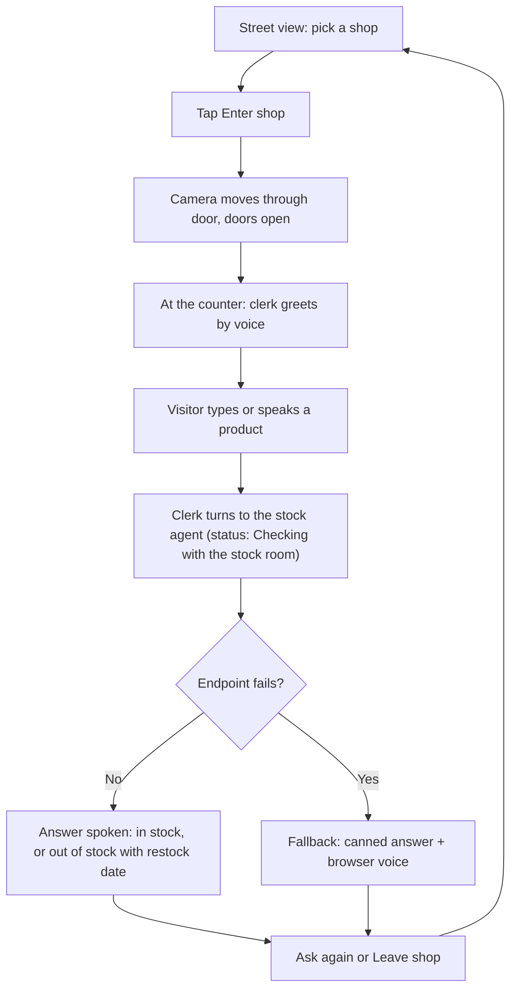
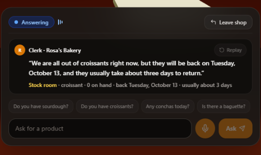
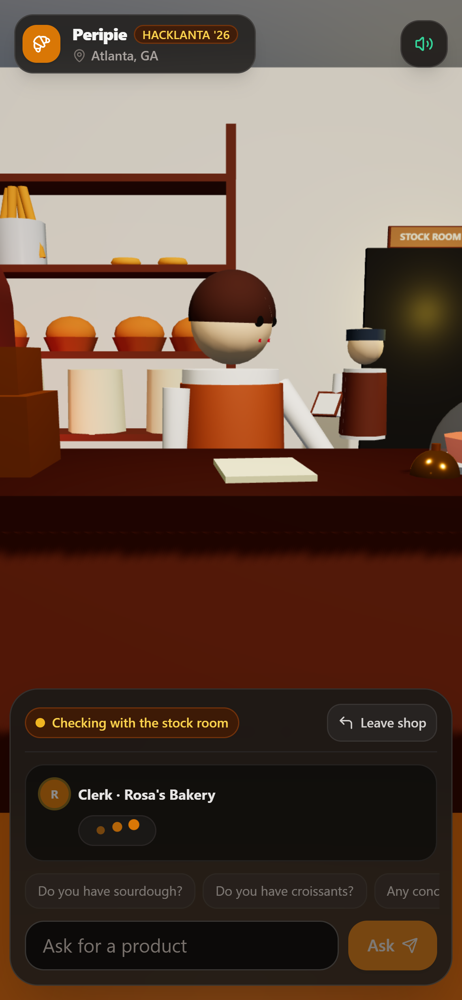

# Visitor flow

This diagram traces the path from the street to the counter and back, including the fallback behavior when the API fails.

## Screens

| Step | Screenshot |
|---|---|
| Street view: pick a shop |  |
| Tap Enter shop |  |
| At the counter: clerk greets by voice |  |
| Clerk turns to the stock agent (status: Checking with the stock room) |  |
| Answer spoken: in stock, or out of stock with restock date |  |
| A different shop template |  |
| The app on a phone |  |

## What the visitor never does

The visitor never creates an account, logs in, or leaves any data behind. No cookies are set, no analytics are sent, and nothing about their question is stored on the server beyond the ephemeral request handling required to answer them.
